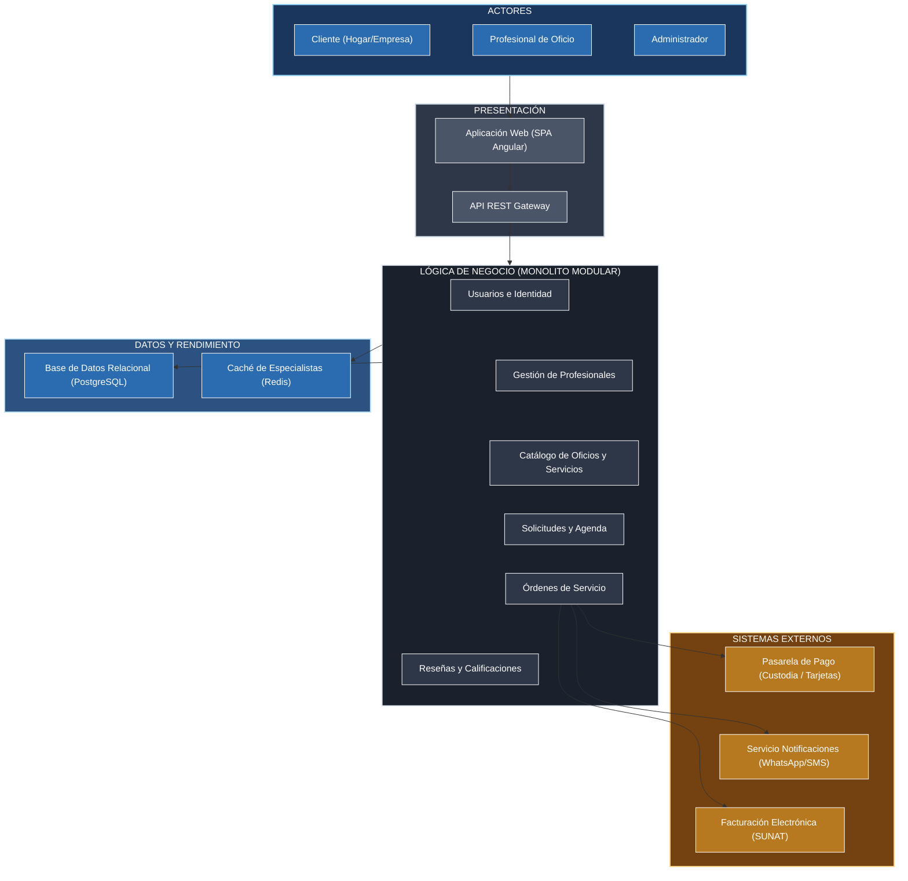

# Arquitectura inicial del sistema

## Diagrama de arquitectura

## Descripción

La arquitectura del sistema **ConectaOficios** se estructura en capas y componentes desacoplados:

- **Presentación:** La aplicación web interactiva desarrollada como SPA en Angular ofrece interfaces específicas para clientes (búsqueda de oficios, solicitud de visita técnica y pagos) y para profesionales técnicos (gestión de perfil, agenda y órdenes). La comunicación hacia el servidor se efectúa mediante una API REST en formato JSON.
- **Lógica de negocio (Monolito Modular con Clean Architecture):** Agrupa los módulos centrales del dominio de servicios:
  - *Usuarios e Identidad:* Registro, inicio de sesión y control de acceso basado en roles.
  - *Gestión de Profesionales:* Validación de técnicos capacitados, acreditaciones y tarifas.
  - *Catálogo de Oficios y Servicios:* Organización por categorías (electricidad, gasfitería, carpintería, cerrajería, pintura, etc.).
  - *Solicitudes y Agenda:* Gestión de visitas programadas y verificación de disponibilidad horaria.
  - *Órdenes de Servicio:* Orquestación de la contratación, estados de avance del trabajo y garantía de satisfacción.
  - *Calificaciones:* Reputación, valoración con estrellas y comentarios verificados.
- **Datos y Rendimiento:** PostgreSQL garantiza la consistencia transaccional y financiera de los contratos y pagos; Redis se utiliza como memoria caché para acelerar la consulta de los técnicos más valorados y oficios frecuentes.
- **Sistemas Externos:** La pasarela de pagos retiene en custodia los fondos de la contratación hasta la conformidad del cliente, mientras que el servicio de mensajería (WhatsApp/SMS) notifica confirmaciones de visita técnica y llegadas a domicilio en tiempo real.