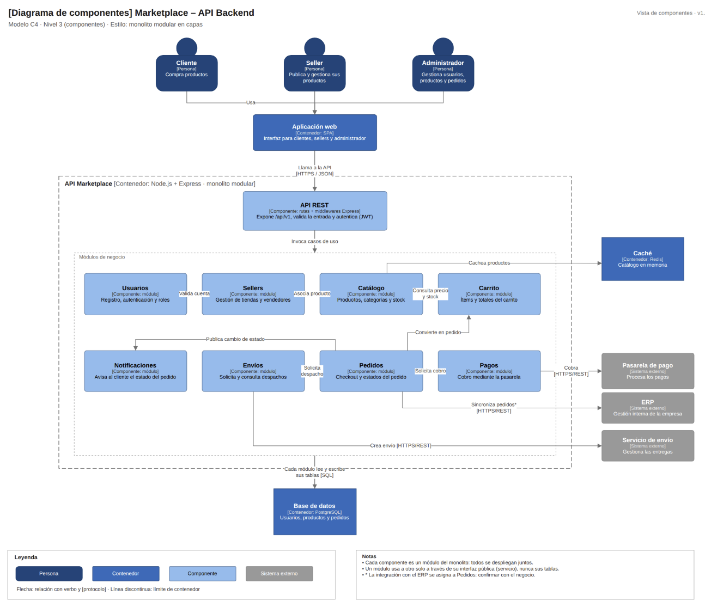

# Componentes arquitectónicos de ConectaOficios

La plataforma organiza sus componentes siguiendo el paradigma de **Clean Architecture (Arquitectura Limpia)**, estructurando la solución en cuatro capas concéntricas con regla de dependencia estricta hacia el centro (Dominio):

1. **Capa de Dominio:**
   - **Entidades:** `Servicio`, `Profesional`, `SolicitudServicio`, `OrdenServicio`.
   - **Objetos de Valor:** `Tarifa`, `Turno`, `Calificacion`, `Garantia`.
   - **Puertos / Contratos:** Interfaces puras que definen qué operaciones requiere el negocio (`RepositorioServicios`, `RepositorioOrdenes`, `ProcesadorPagos`, `NotificadorCliente`).

2. **Capa de Aplicación:**
   - **Casos de Uso:** Orquestan la lógica de negocio sin depender de frameworks (`ConsultarServiciosCasoUso`, `AgregarServicioSolicitudCasoUso`, `ContratarServicioCasoUso`).

3. **Capa de Infraestructura:**
   - **Adaptadores de Persistencia:** Implementaciones con bases de datos relacionales o repositorios en memoria (`RepositorioServiciosMemoria`, `RepositorioServiciosHttp`).
   - **Adaptadores de Integración Externa:** Conexión con proveedores de pasarela (`ProcesadorPagosNiubiz`, `ProcesadorPagosSimulado`) y mensajería (`NotificadorWhatsApp`, `NotificadorConsola`).

4. **Capa de Presentación:**
   - **Controladores / Componentes Web:** Vistas SPA en Angular (`CatalogoComponent`, `CarritoComponent` / `SolicitudComponent`, `AppComponent`) y servicios de estado reactivo.

