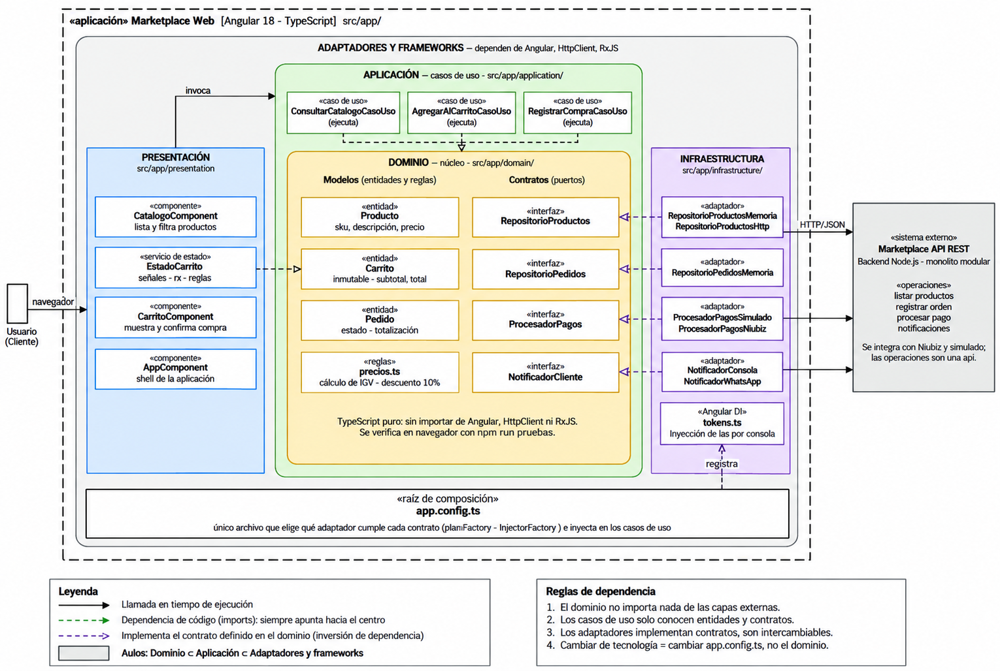

# Enfoque arquitectónico de ConectaOficios

Se utiliza el enfoque **Clean Architecture (Arquitectura Limpia)** para separar las reglas esenciales del negocio de los detalles de implementación tecnológica.

| Elemento | Descripción aplicada a ConectaOficios |
|---|---|
| **Patrón / enfoque arquitectónico** | Clean Architecture (Arquitectura Limpia de Robert C. Martin). |
| **Objetivo** | Aislar las reglas de negocio de servicios de oficios, tarifas, cálculo de garantías y ordenes de contratación, orientando todas las dependencias hacia el Dominio central. |
| **¿Qué problema resuelve?** | Elimina el acoplamiento directo entre los componentes visuales de Angular, la lógica de negocio y las tecnologías externas (PostgreSQL, APIs de pago Niubiz/Stripe, WhatsApp). |
| **Capas definidas** | Presentación, Aplicación, Dominio e Infraestructura. |
| **Beneficios** | • Las reglas de negocio se pueden probar al 100 % sin navegador ni base de datos (`npm run pruebas`). • Permite sustituir proveedores de pago o canales de notificación sin tocar los casos de uso. • Facilita la incorporación de nuevas especialidades técnicas (gasfitería, electricidad, etc.) de forma modular y mantenible. |

